> **Historical document.** These diagrams describe the app before the
> Night Market redesign (group-first canvas, ledger, timeline and settle
> board). Kept for context only — the current UI is documented in README.md.

# SplitMate — Complete Application Flow

## 1. Top-Level Navigation & Shell

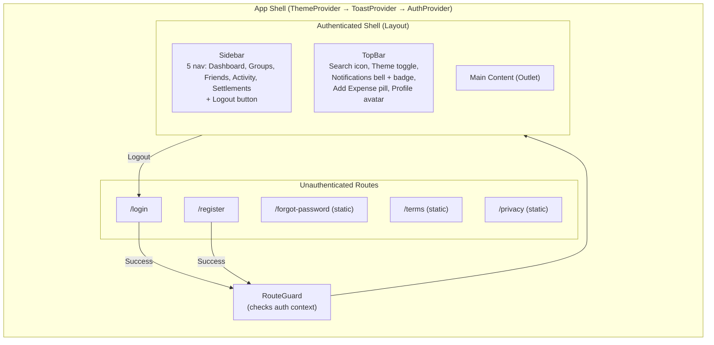

## 2. Login Page

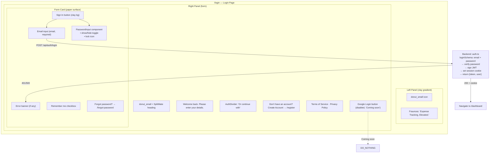

## 3. Register Page

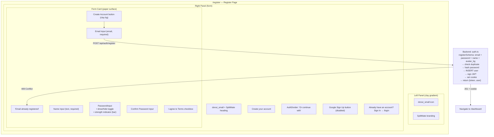

## 4. Dashboard Page

```mermaid
flowchart TD
    subgraph DASHBOARD["/dashboard — Dashboard"]
        direction TB
        
        HEADER["'Dashboard' headline + 'Here's your financial overview.'"]
        
        subgraph HeroBalance["Hero Balance Card (full width, clay border)"]
            BALANCE_ICON["clay bg icon"]
            BALANCE_LABEL["'Total Balance'"]
            BALANCE_AMOUNT["₹659.60 (Fraunces, large)"]
            BALANCE_SUB["'Across all your groups'"]
        end
        
        subgraph SupportingCards["Supporting Cards (2-col grid)"]
            OWED_CARD["You're Owed (teal border)<br/>₹659.60"]
            OWE_CARD["You Owe (red border)<br/>₹0.00"]
        end
        
        subgraph ContentGrid["2-column Content Grid"]
            subgraph ActivityPanel["Recent Activity (left)"]
                ACTIVITY_HEADER["'Recent Activity' + 'View all →'"]
                ACTIVITY_ITEM1["BlobAvatar + Demo User 1<br/>added an expense<br/>+₹450.00 · 2h ago"]
                ACTIVITY_ITEM2["BlobAvatar + Demo User 2<br/>joined a group<br/>1d ago"]
                ACTIVITY_EMPTY["EmptyState (if no activity)"]
                VIEW_ALL["'View all →' → /activity"]
            end
            
            subgraph GroupsPanel["My Groups (right)"]
                GROUPS_HEADER["'My Groups' + 'Create New Group'"]
                GROUP_ITEM1["CategoryIcon + Weekend Gang<br/>+₹120.00"]
                GROUP_ITEM2["CategoryIcon + Apartment 4B<br/>-₹50.00"]
                GROUP_EMPTY["EmptyState: 'No groups yet'<br/>Create Group button → /groups?new=1"]
                CREATE_GROUP["'Create New Group →' → /groups?new=1"]
            end
        end
    end
    
    VIEW_ALL --> NAV_ACTIVITY["Navigate to /activity"]
    CREATE_GROUP --> NAV_GROUPS["Navigate to /groups?new=1"]
    
    subgraph API["API Calls"]
        BALANCES_API["GET /api/balances → {groups, friends, total}"]
        ACTIVITY_API["GET /api/activity?limit=5 → {events}"]
    end
```

## 5. Groups Page

```mermaid
flowchart TD
    subgraph GROUPS["/groups — My Groups"]
        direction TB
        
        HEADER["'My Groups' headline"]
        
        subgraph Toolbar["Toolbar"]
            SEARCH["Search input (filters by name)"]
            FILTER_BTN["Filter icon button"]
            DROPDOWN["'All Groups' dropdown"]
            NEW_GROUP_BTN["New Group button (clay) → opens modal"]
        end
        
        subgraph GroupCards["Group Cards (list layout)"]
            CARD1["CategoryIcon (star) + Weekend Gang<br/>social · 8 members<br/>Avatar stack (DL +2)<br/>YOUR BALANCE: +₹120.00"]
            CARD2["CategoryIcon (briefcase) + Office Lunch<br/>office · 5 members<br/>Avatar stack (AB +3)<br/>YOUR BALANCE: +₹45.00"]
            CARD3["CategoryIcon (house) + Apartment 4B<br/>home · 4 members<br/>Avatar stack (MK +2)<br/>YOUR BALANCE: -₹50.00"]
            CARD4["CategoryIcon (star) + Goa Trip 2026<br/>trip · 8 members<br/>Avatar stack (RS +5)<br/>YOUR BALANCE: +₹250.00"]
            EMPTY_STATE["EmptyState: 'No groups yet'"]
        end
        
        subgraph CreateModal["Create Group Modal"]
            MODAL_INPUT["Group Name input"]
            MODAL_CANCEL["Cancel button"]
            MODAL_CREATE["Create Group button"]
        end
    end
    
    CARD1 -->|"Click"| GROUP_DETAIL["Navigate to /groups/:id"]
    CARD2 --> GROUP_DETAIL
    CARD3 --> GROUP_DETAIL
    CARD4 --> GROUP_DETAIL
    
    NEW_GROUP_BTN --> MODAL_INPUT
    MODAL_CREATE -->|"POST /api/groups"| SUCCESS["Toast: 'Group created'"]
    SUCCESS --> REFETCH["Refetch groups list"]
    
    URL_PARAM{"?new=1 in URL?"}
    URL_PARAM -->|Yes| MODAL_INPUT
    
    subgraph API["API Call"]
        GROUPS_API["GET /api/groups → {groups: [...]}"]
    end
```

## 6. Group Detail Page

```mermaid
flowchart TD
    subgraph GROUP_DETAIL["/groups/:id — Group Detail"]
        direction TB
        
        subgraph GroupHeader["Header"]
            CAT_ICON["CategoryIcon (large, 64px)"]
            GROUP_NAME["Group name (Fraunces)"]
            GROUP_META["type · N members"]
            INVITE_BTN["Invite button → invite modal"]
            ADD_EXPENSE_BTN["Add Expense → /expenses/add?group=:id"]
            SETTLE_BTN["Settle Up → settle modal"]
        end
        
        subgraph StatsRow["Stats Row (3 cards)"]
            GROUP_NET["Group Net"]
            MY_SHARE["My Share"]
            SETTLED["Settled"]
            PENDING["Pending"]
        end
        
        subgraph MembersSection["Members"]
            MEMBER1["BlobAvatar + User A<br/>You paid ₹450.00<br/>+₹120.00"]
            MEMBER2["BlobAvatar + User B<br/>They paid ₹200.00<br/>-₹50.00"]
        end
        
        subgraph ExpensesSection["Expenses"]
            EXP_HEADER["'Expenses' + 'Add' link"]
            EXP1["restaurant icon + Dinner<br/>₹800.00 · Aug 5<br/>Paid by User A"]
            EXP2["directions_car icon + Cab fare<br/>₹350.00 · Aug 4<br/>Paid by User B"]
            EXP_EMPTY["EmptyState: 'No expenses yet'<br/>Add Expense button"]
        end
        
        subgraph SettlementsSection["Settlements"]
            SETT_HEADER["'Settlements'"]
            SETT1["User A → User B<br/>₹200.00 · pending<br/>Confirm button · Remove button"]
            SETT_EMPTY["EmptyState: 'No settlements yet'"]
        end
        
        subgraph Modals["Modals"]
            subgraph InviteModal["Invite Member Modal"]
                INVITE_EMAIL["Email input"]
                INVITE_CANCEL["Cancel"]
                INVITE_SEND["Send Invite"]
            end
            
            subgraph SettleModal["Settle Up Modal"]
                SETTLE_PAYTO["Pay to: select member"]
                SETTLE_AMOUNT["Amount (₹) input"]
                SETTLE_NOTE["Note (optional)"]
                SETTLE_CANCEL["Cancel"]
                SETTLE_RECORD["Record button"]
            end
        end
    end
    
    EXP1 -->|"Click"| EXPENSE_DETAIL["Navigate to /expenses/:id"]
    SETTLE_RECORD -->|"POST /api/groups/:id/settlements"| SETTLE_SUCCESS["Toast: 'Settlement recorded'"]
    INVITE_SEND -->|"POST /api/groups/:id/invite"| INVITE_SUCCESS["Toast: 'Invite sent'"]
    
    subgraph API["API Calls"]
        GROUP_API["GET /api/groups/:id → {group, expenses, settlements}"]
        BALANCES_GROUP["GET /api/groups/:id/simplify → {transactions}"]
    end
```

## 7. Friends Page

```mermaid
flowchart TD
    subgraph FRIENDS["/friends — Friends"]
        direction TB
        
        HEADER["'Friends' headline + subtitle"]
        ADD_FRIEND_BTN["Add Friend button (clay) → opens modal"]
        
        subgraph Tabs["Tabs"]
            FRIENDS_TAB["Friends (11)"]
            REQUESTS_TAB["Requests (2) <Badge>"]
        end
        
        subgraph FriendsList["Friends Tab — 3-col grid"]
            FRIEND_CARD1["BlobAvatar (green) + Demo User 1<br/>demo001@splitmate.app<br/>₹37.50 (positive, clay)<br/>Settle Up button"]
            FRIEND_CARD2["BlobAvatar (pink) + Demo User 2<br/>demo002@splitmate.app<br/>₹0.00<br/>Settle Up button"]
            FRIEND_EMPTY["EmptyState: 'No friends yet'"]
        end
        
        subgraph RequestsList["Requests Tab"]
            INCOMING_ROW["Demo User 3<br/>incoming badge<br/>Accept · Decline buttons"]
            OUTGOING_ROW["Demo User 4<br/>outgoing badge"]
            REQUESTS_EMPTY["'No requests'"]
        end
        
        subgraph AddFriendModal["Add Friend Modal"]
            FRIEND_EMAIL["Friend's email input"]
            FRIEND_CANCEL["Cancel"]
            FRIEND_SEND["Send Request"]
        end
    end
    
    FRIEND_CARD1 -->|"Click 'Settle Up'"| SETTLEMENTS["Navigate to /settlements"]
    ACCEPT_BTN["Accept"] -->|"PATCH /api/friends/requests/:id/accept"| ACCEPT_SUCCESS["Toast: 'Friend added'"]
    DECLINE_BTN["Decline"] -->|"PATCH /api/friends/requests/:id/decline"| DECLINE_SUCCESS["Toast: 'Request declined'"]
    FRIEND_SEND -->|"POST /api/friends/requests"| SEND_SUCCESS["Toast: 'Request sent'"]
    
    subgraph API["API Calls"]
        FRIENDS_API["GET /api/friends → {friends: [...]}"]
        REQUESTS_API["GET /api/friends/requests → {incoming, outgoing}"]
    end
```

## 8. Activity Page

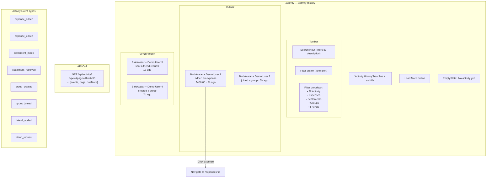

## 9. Settlements Page

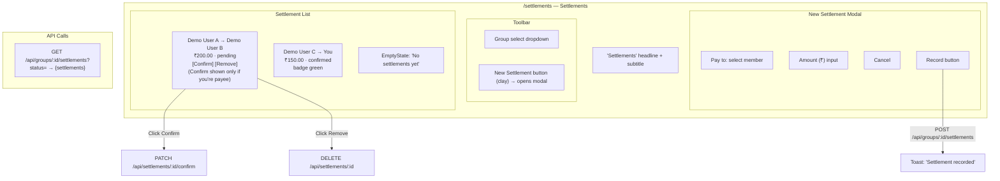

## 10. Add Expense Page

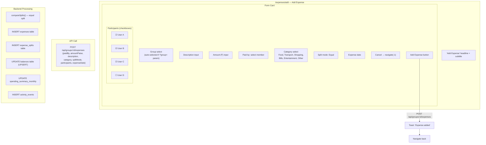

## 11. Expense Details Page

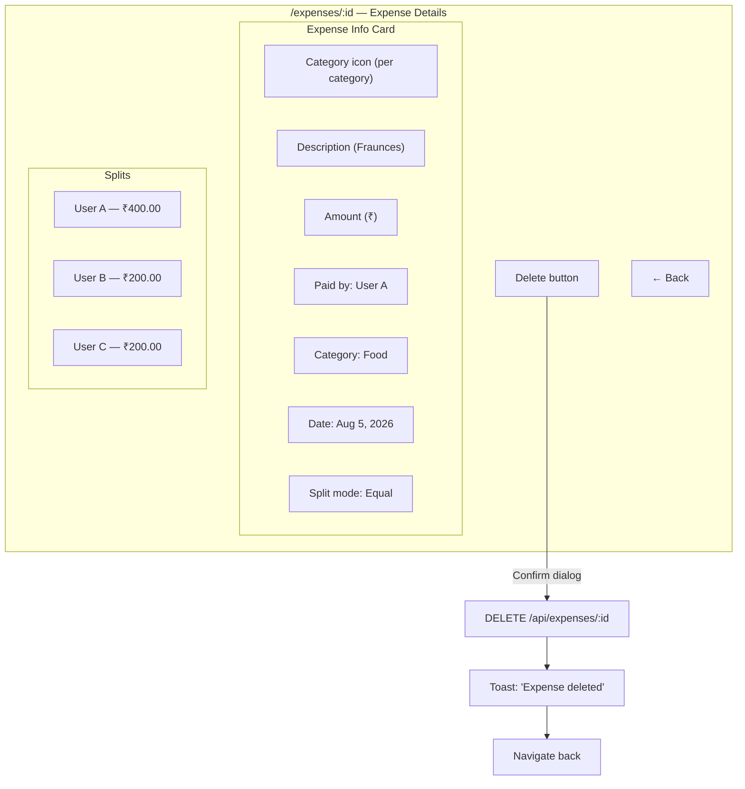

## 12. Analytics Page

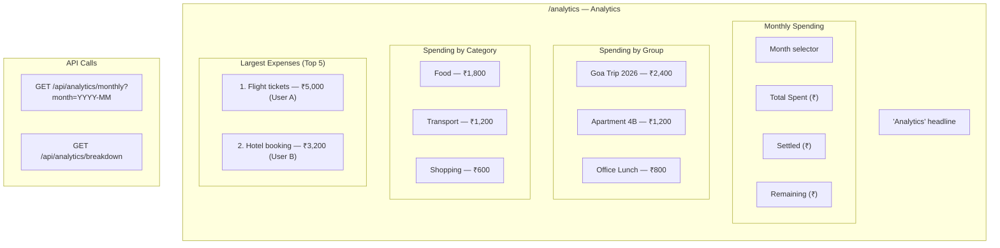

## 13. Profile & Settings Page

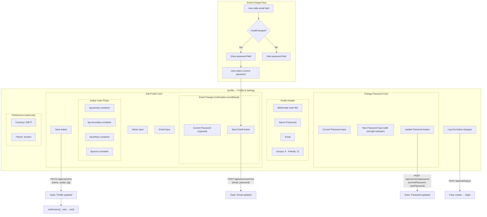

## 14. Notifications Page

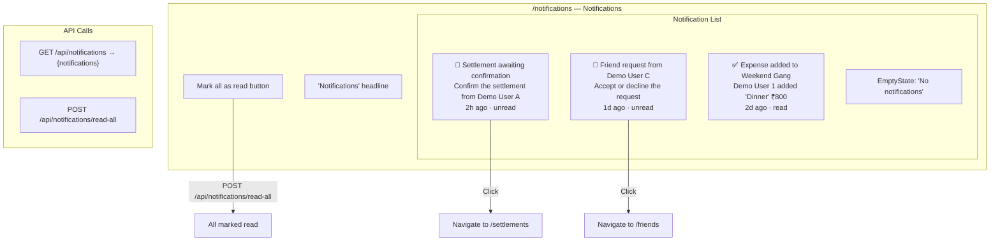

## 15. Theme Toggle (Global)

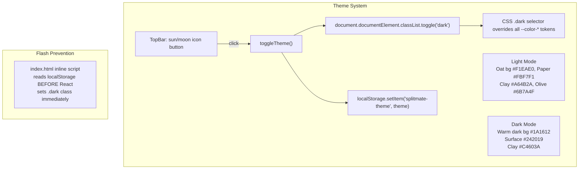

## 16. Complete Backend API Map

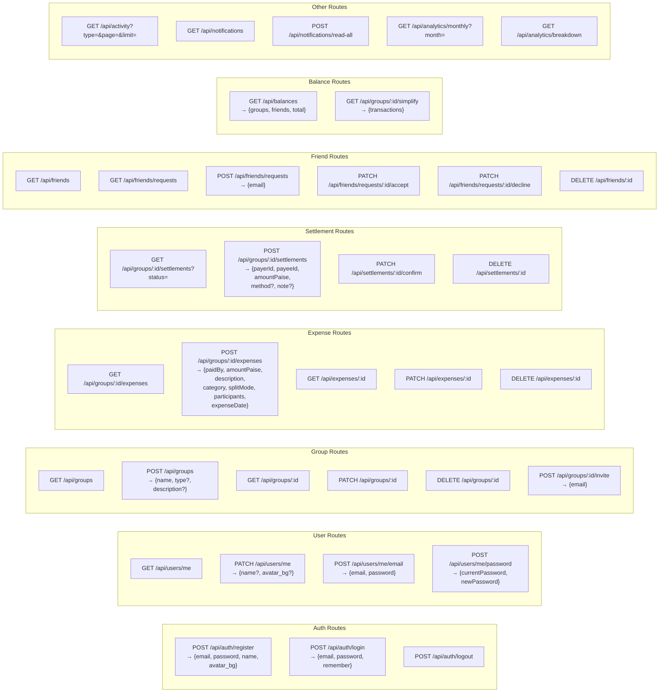

## 17. Data Flow Summary

```mermaid
flowchart TD
    subgraph UserActions["User Actions"]
        A1["Login / Register"]
        A2["View Dashboard"]
        A3["Create Group"]
        A4["Invite Member"]
        A5["Add Expense"]
        A6["Record Settlement"]
        A7["Confirm Settlement"]
        A8["Send Friend Request"]
        A9["Accept Friend Request"]
        A10["Update Profile"]
        A11["Change Password"]
        A12["Toggle Theme"]
    end
    
    subgraph SideEffects["Side Effects"]
        SE1["JWT cookie set"]
        SE2["Balance recalculation"]
        SE3["Monthly spending updated"]
        SE4["Activity event logged"]
        SE5["Notification created"]
        SE6["Auth context updated"]
        SE7["CSS class toggled"]
        SE8["localStorage updated"]
    end
    
    A1 --> SE1
    A5 --> SE2
    A5 --> SE3
    A5 --> SE4
    A6 --> SE5
    A8 --> SE5
    A9 --> SE6
    A10 --> SE6
    A12 --> SE7
    A12 --> SE8
```
